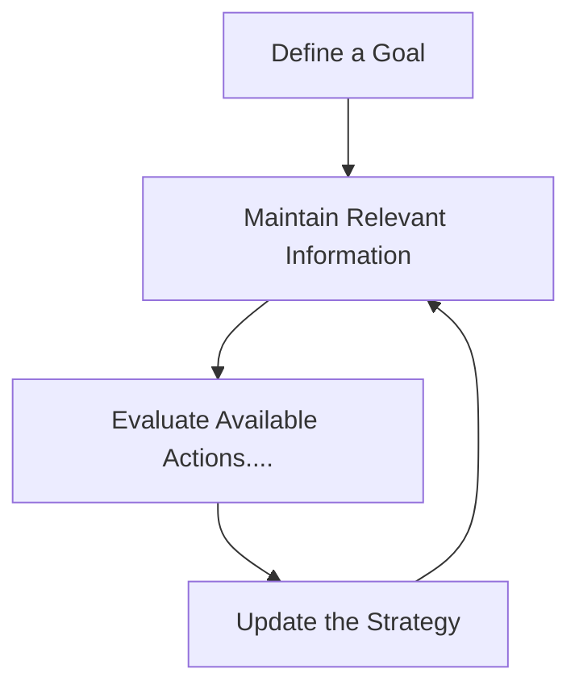

# The Prefrontal Cortex

> *The brain is not merely a machine for reacting to the world. It is also a system for ...*

The **prefrontal cortex (PFC)** is the frontmost part of the frontal lobes of the brain. 

## Working Memory

1. A simplified example in Python illustrates how information can be maintained and updated during a task:

```python
steps = [12, 8, 5]
total = 0

for step in steps:
    total += step

print(total)  # 25
```

2. Consider these situations:

- You want to browse social media, but you continue studying.
- You feel angry, but you pause before responding.
- You recognize an obvious answer, but check whether the evidence supports it.

| Factor | General relationship                                         | Important qualification                                      |
| ------ | ------------------------------------------------------------ | ------------------------------------------------------------ |
| Age    | Executive functions often improve through development        | Different abilities follow different trajectories            |
| Sleep  | Supports attention, memory, and cognitive performance        | One good night's sleep cannot compensate for chronic sleep deprivation |
| Stress | Can impair some forms of working memory and flexible thinking | Effects depend on intensity, duration, and context           |



## A Mathematical Perspective

A simplified decision model can represent the value of an action as the expected benefit minus the expected cost:
$$
V(a) = \mathbb{E}[R \mid a] - \lambda \mathbb{E}[C \mid a]
$$
*Further reading:*

- [National Institute of Mental Health](https://www.nimh.nih.gov/) — Research on brain function and mental health.
- [National Institute of Neurological Disorders and Stroke](https://www.ninds.nih.gov/) — Information about the brain and nervous system.
- [PubMed](https://pubmed.ncbi.nlm.nih.gov/) — A searchable database of biomedical research.