---

# 一级标题

## 二级标题

### 三级标题

这是普通段落。**粗体**，*斜体*，***粗斜体***，~~删除线~~，<u>下划线</u>，`行内代码`，H~2~O（下标），X^2^（上标） ，键盘按键：<kbd>⌘</kbd>

-   TypeScript
    -   类型系统

1.  明确问题
    1.  检查正常路径

-   [x] 检查 Mermaid 渲染
-   [ ] 检查数学公式

> 一级引用：Markdown 是轻量级标记语言。
>
> > 二级引用：适合记录结构化知识。
> >
> > -   引用中可以嵌套列表也可以包含 `代码`

-   行内链接：[Typora 官网](https://typora.io/)
-   自动链接：<https://typora.io/>


| A    | B    |
| ---- | ---- |
| 1    | 2    |
| 3    | 4    |

``` javascript
const debounce = (fn, delay = 300) => {
  let timer;
  return (...args) => {
    clearTimeout(timer);
    timer = setTimeout(() => fn(...args), delay);
  };
};

const search = debounce((keyword) => {
  console.log("search:", keyword);
}, 300);

search("Typora");
```

行内公式：质能关系 \(E = mc^2\)，以及二次方程求根公式中的判别式 \(\Delta = b^2 - 4ac\)。

独立公式：

$$
\int_{-\infty}^{+\infty} e^{-x^2}\,dx = \sqrt{\pi}
$$

这里有一个脚注引用。[^note]

<details>
<summary>点击展开 HTML 折叠区</summary>
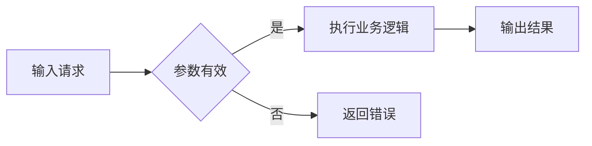

### 饼图

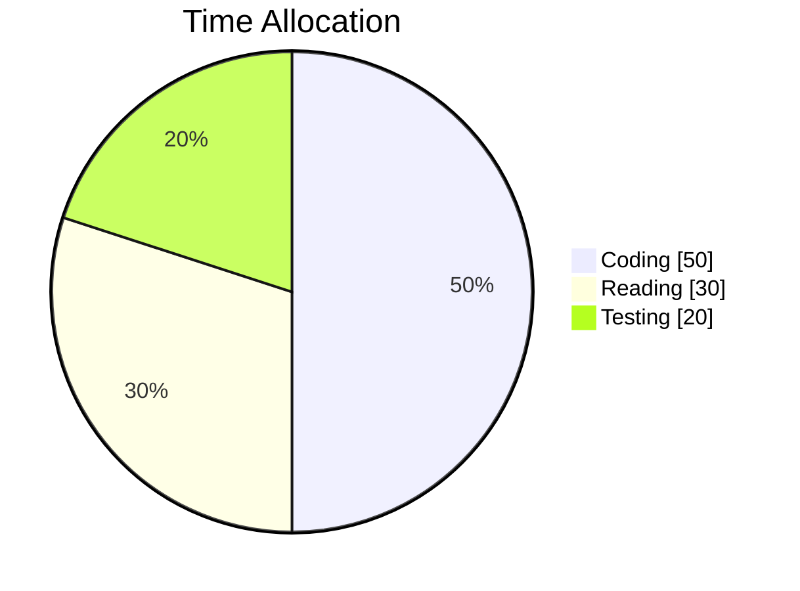

### 思维导图（需较新 Mermaid 版本）

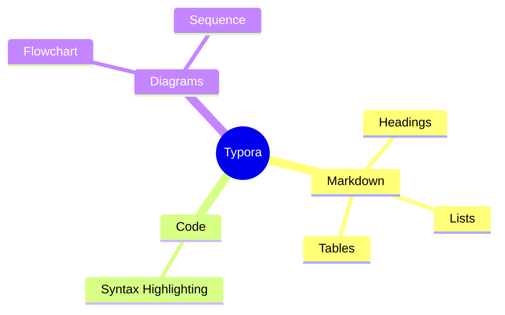

### 流程图

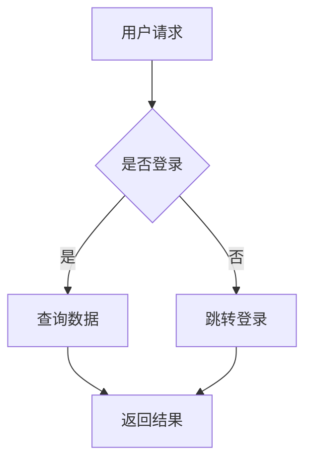


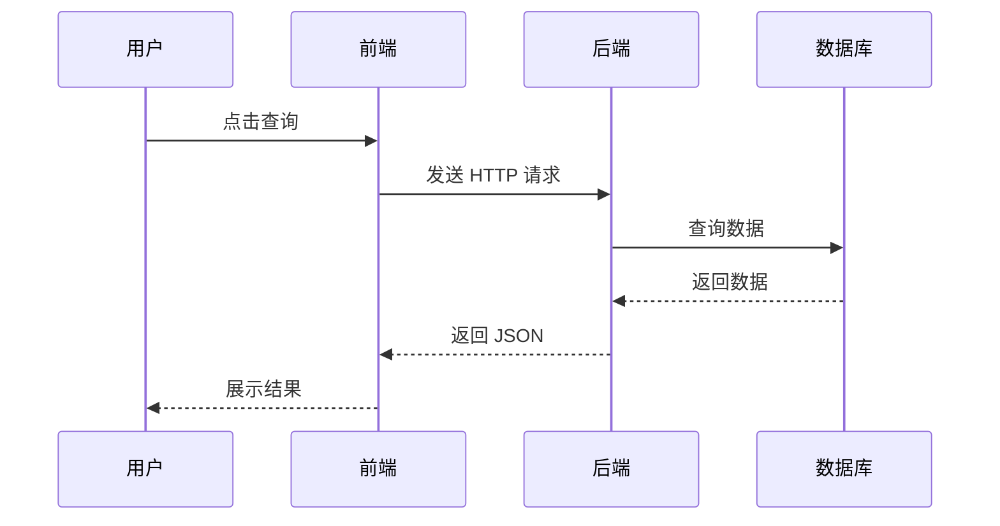


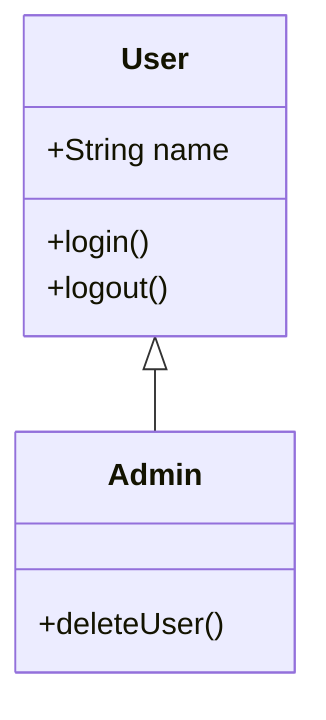


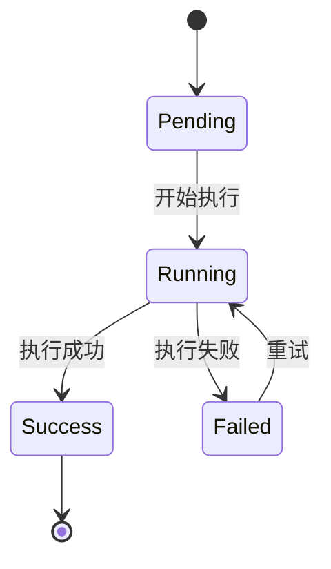

### ER图

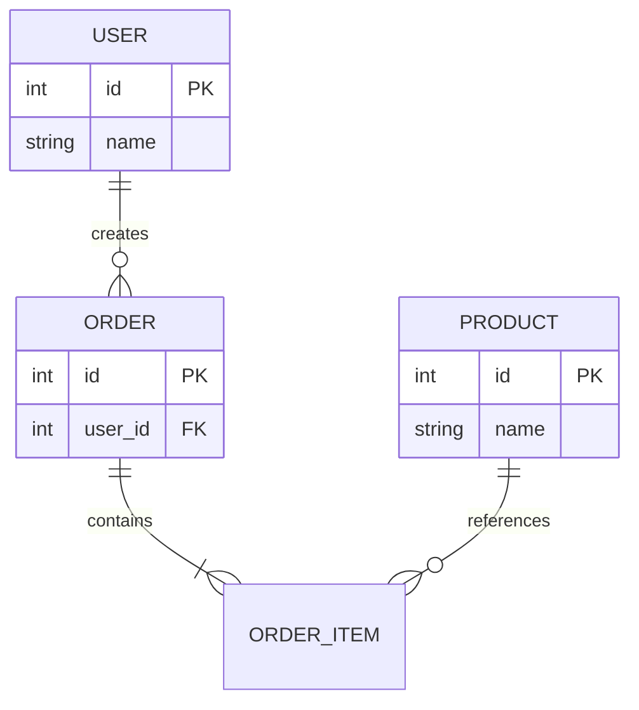

### 甘特图

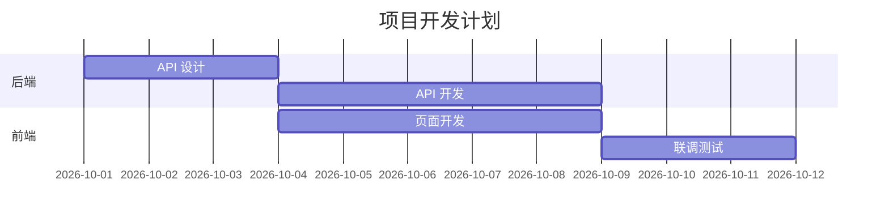

### 时间线

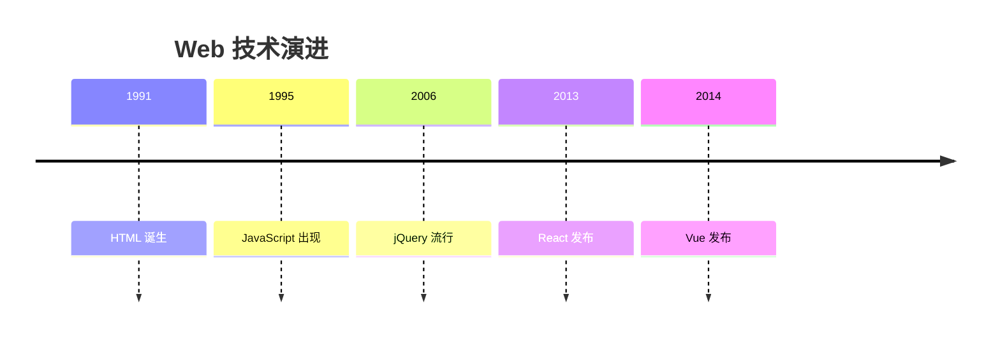

### 架构图

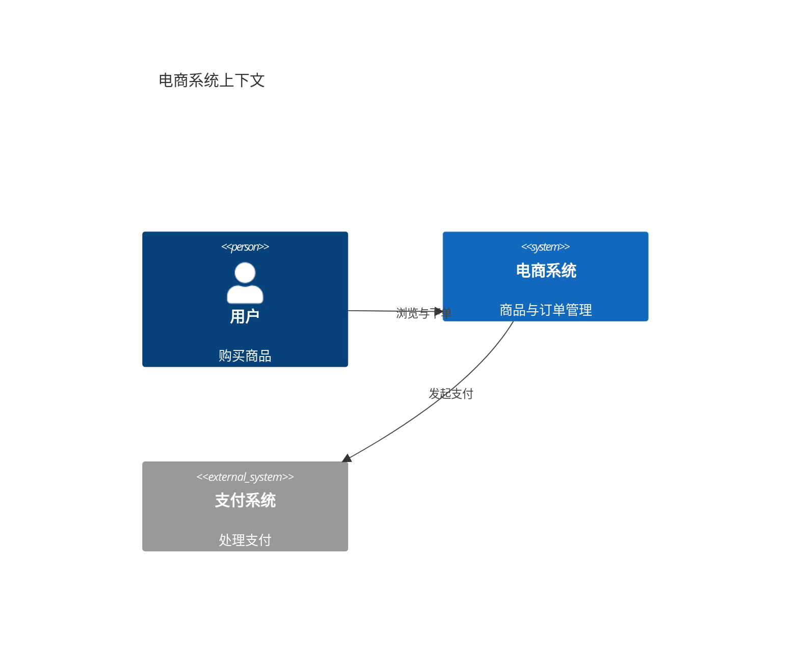

### X-Y图表

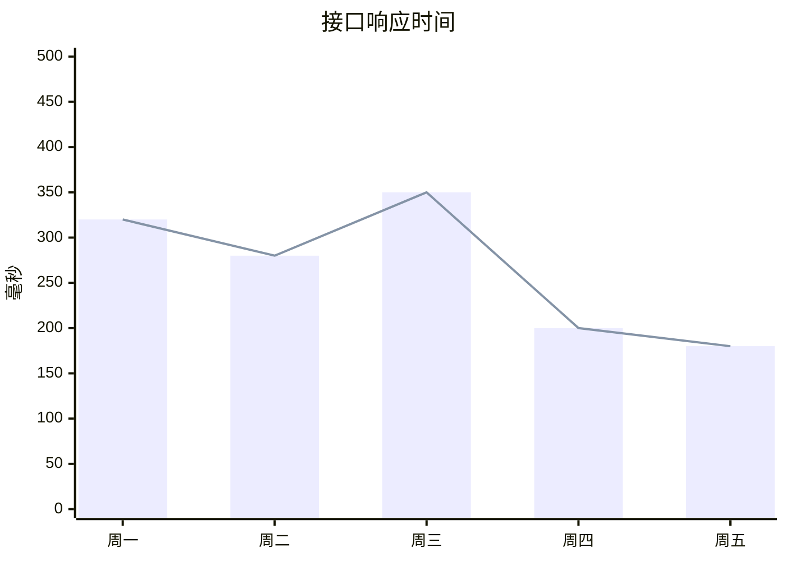

### 看板图

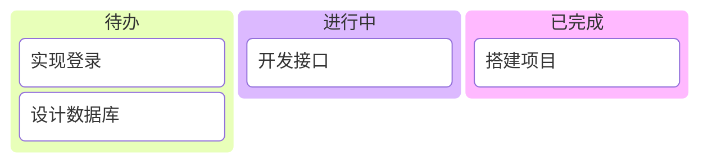

### 数据包图

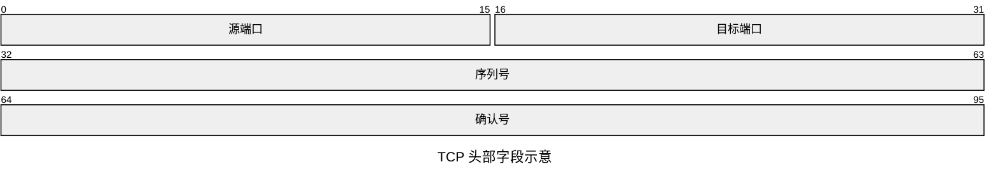
